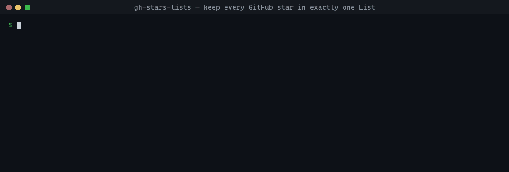

# gh-stars-lists

Keep every GitHub star in **exactly one** [GitHub List](https://docs.github.com/en/account-and-profile/setting-up-and-managing-your-personal-account-on-github/managing-your-personal-account/managing-your-stars), without letting a script touch your account blindly.

GitHub caps you at 32 Lists and gives you no tool to sort hundreds of stars into them. This is a single Python file on top of the GitHub CLI that:

- **audits** your account: stars in no list, stars in several lists, list members you no longer star;
- **proposes** a list for each unsorted star with a scored classifier, and tells you why;
- **applies** only a manifest you reviewed and approved, one repo at a time, reading the live state back after every change;
- **rolls back** any applied manifest;
- **exports** a Markdown catalog of all your lists.

Built and used on a real account: 522 stars sorted into 32 lists, audit `PASS`.



*Replay of a real run on 21 Nov 2026: six new stars get a proposed list, the reviewed manifest is applied, and the audit passes.*

## Requirements

- Python 3.10+ (standard library only; CI tests 3.10 and 3.14)
- [GitHub CLI](https://cli.github.com/) logged in, with the `user` scope (needed to change Lists):

```bash
gh auth login
gh auth refresh -h github.com -s user
```

## Quick start

```bash
# 1. Read-only audit of the whole account (exit 0 = PASS, 1 = findings)
python gh_stars_lists.py --audit

# 2. Write a review manifest for every unlisted / multi-listed star (read-only)
python gh_stars_lists.py --plan runs/2026-11-21/manifest.json

# 3. Review it by hand (see below), set "review": "APPROVED", then dry-run
python gh_stars_lists.py --apply-manifest runs/2026-11-21/manifest.json

# 4. Apply for real: serial, read back after each op, journaled to runs/2026-11-21/manifest-journal.jsonl
python gh_stars_lists.py --apply-manifest runs/2026-11-21/manifest.json --confirm

# 5. Audit again: it should say PASS
python gh_stars_lists.py --audit
```

Other commands:

```bash
python gh_stars_lists.py                     # audit only the 30 most recent stars (--limit N for more)
python gh_stars_lists.py --apply-manifest FILE.json --rollback --confirm   # undo a manifest
python gh_stars_lists.py --export-catalog stars.md                         # Markdown catalog (stdout without PATH)
python gh_stars_lists.py --taxonomy          # list names the classifier can propose
python gh_stars_lists.py --test              # offline unit tests
python gh_stars_lists.py --account LOGIN ... # refuse to run under any other gh login
```

## Reviewing a manifest

`--plan` writes JSON like this, always with `"review": "PENDING"`:

```json
{
 "review": "PENDING",
 "ops": [
  {
   "group": "UNLISTED",
   "repo": "rustdesk/rustdesk",
   "repo_id": "R_kgDO...",
   "from": null,
   "to": "Infra",
   "to_list_id": "UL_kwDO...",
   "reason": "classifier (needs review): Tier 2: Infra 5, Mobile 3"
  }
 ]
}
```

For each op:

- **Agree?** Leave it.
- **Wrong list?** Change `to` to the right list name and **delete `to_list_id`** (it is looked up from the name when you apply).
- **Not sure / don't want it?** Delete the op.

Then set `"review": "APPROVED"`. The apply step refuses a manifest that is still `PENDING`, has no `review` field, names a list that does not exist, has a `to_list_id` that no longer matches `to`, repeats a repo, or was planned for another account. All of that is checked before the first mutation.

## Safety model

| Guard | What it does |
|---|---|
| No blind apply | The classifier only writes proposals. Nothing changes until an `APPROVED` manifest runs with `--confirm`. |
| State check before each op | An op runs only if the repo's live lists still equal `from`. Already at `to` reads as `ALREADY`; anything else is `SKIP_STATE_MISMATCH`. |
| Readback, not trust | `OK` means a fresh read after the mutation matches the target and the repo is still starred. A mismatch stops the run. |
| Safe retries | Reads retry on GitHub 5xx, timeouts and truncated responses (3, 10, 30, 60 s). Mutations never retry: the next live read decides. |
| Re-runnable | Run the same manifest again after a failure: finished ops read as `ALREADY`. |
| Journal + rollback | Every confirmed op is appended to a JSONL journal; `--rollback` swaps `from`/`to` and runs in reverse order. |

Exit codes: `0` success / PASS, `1` findings or a `SKIP_*`/`FAIL` op, `2` input rejected.

## How the classifier decides

Each list has a set of regex patterns matched against `owner/name description topics` (lowercased; `-`, `_`, `.` in the repo name read as spaces). Every distinct pattern that matches adds 1 point, plus 1 more when it matches inside the repo name. Lists are scored in tiers:

1. **Tier 1, strong signals** decide alone: LLM proxies/relays → `Router`, "turn X into a skill" → `Skills`, social-platform audience research → `Socmed`, skill packs for designers → `Design`.
2. **Tier 2, business domains** (`Crypto`, `Stocks`, `Finance`, `Documents`, `Mobile`, `Design`, `Video & Images`, `Audio`, `Writing`, `Socmed`, `Marketing`, `Mail`, `Productivity`, `Cloud & Storage`, `Infra`, `Security`, `Research`). The top domain wins with 2x the runner-up or a 2-point lead; a few tie rules (Crypto over Stocks, Documents over the rest) settle close calls.
3. **Tier 3, AI specialties** (`Router`, `AI Models`, `AI Decisions`, `Memory`, `Code`, `Computer Use`, `Browser`, `Crawl`, `Agent`) take a repo from the Tier 2 winner only by scoring strictly higher.
4. **Tier 4, generic formats** (`Skills`, `Prompts`, `API & MCP`) need a 2-point lead over a Tier 2 winner. `References` is the fallback for awesome-lists and cheat sheets.
5. Still ambiguous → `Others`.

So a "Postgres MCP server" lands in `Cloud & Storage`, not `API & MCP`: the domain outranks the format.

On the account it was built for, the classifier puts 441 of 522 hand-reviewed stars (84.5%) in the same list a human chose. Those rules were tuned on that same account, so treat the number as an upper bound and keep reviewing.

### Using your own lists

The proposals use the 31 names printed by `--taxonomy`. You have two options:

- **Create the lists you want** from that set in the GitHub UI (Stars → Lists → Create list). A proposal for a list you don't have becomes `Others` if you have an `Others` list, otherwise `null`, which you must fill in during review.
- **Edit the tables** at the top of `gh_stars_lists.py` (`TIER_1_STRONG`, `TIER_2_BUSINESS_DOMAINS`, `TIER_3_AI_SPECIALTIES`, `TIER_4_GENERIC_FORMATS`) to rename lists or add patterns. Add your own corrections as `_fixture(...)` regression cases so `--test` keeps them fixed.

## Tests

```bash
python gh_stars_lists.py --test
```

Offline, no GitHub access: 79 classifier cases (71 of them real repos the classifier once got wrong), the catalog renderer, manifest validation, and retry error matching. CI runs them on every push.

## License

[MIT](LICENSE)
